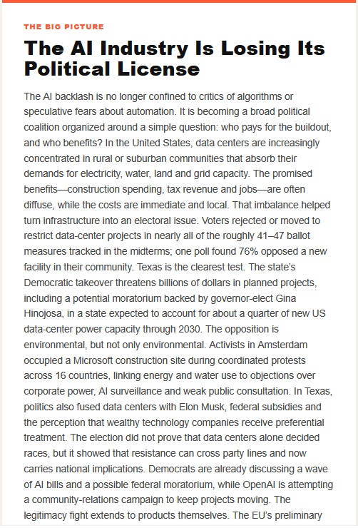
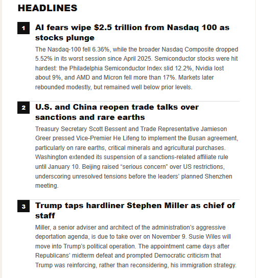
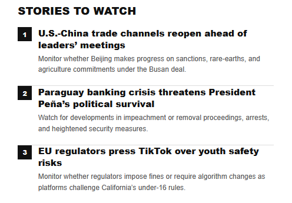

# tamis-news

A pipeline that turns RSS feeds into a daily newsletter for each reader. Stories are collected, enriched, grouped into clusters, then written up and emailed. The stages run separately and pass their work through Amazon S3. An AWS Step Functions workflow starts them. That workflow lives outside this repository.

The pipeline runs across several EC2 instances, one for each of the later stages. Each of those stages has its own virtualenv on its instance.

## Stages

1. **RSSIngestion** runs hourly as an AWS Lambda. It pulls recent stories from hundreds of sources, drops articles already stored, and saves the new ones.
2. **NewsEnrichment** runs daily on its own multi-core EC2 instance. It reads the new articles and pulls the full text. Transformer-based local NLP models extract each article's topics, entities, and vector embeddings. That work is compute-heavy, so the stage runs it in parallel across the instance's cores.
3. **NewsClustering** runs daily on its own EC2 instance after NewsEnrichment. It reduces the dimensionality of the vector embeddings, then uses hierarchical density-based clustering to group articles into stories, scores those stories, and writes a summary for each one.
4. **NewsletterWriting** runs daily on its own EC2 instance after NewsClustering. It picks the stories that fit each reader, drafts that reader's newsletter, saves it, and sends it.

## What the reader receives

Each email is a short briefing in three parts.

**The Big Picture** is the lead piece: one story written out in a few paragraphs.

**Headlines** are three shorter items, each with a title and a brief explanation.

**Stories to Watch** are three developments to follow, each with a note on what to look for next.

